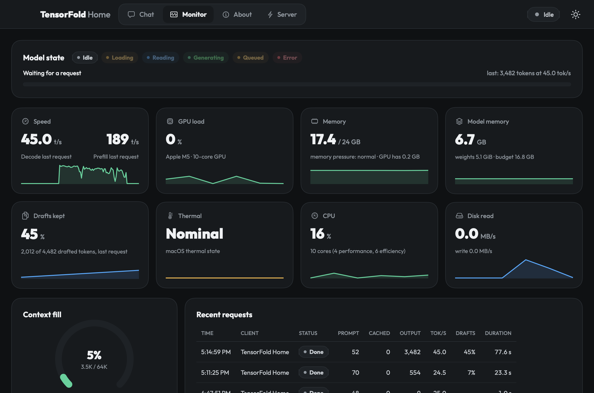
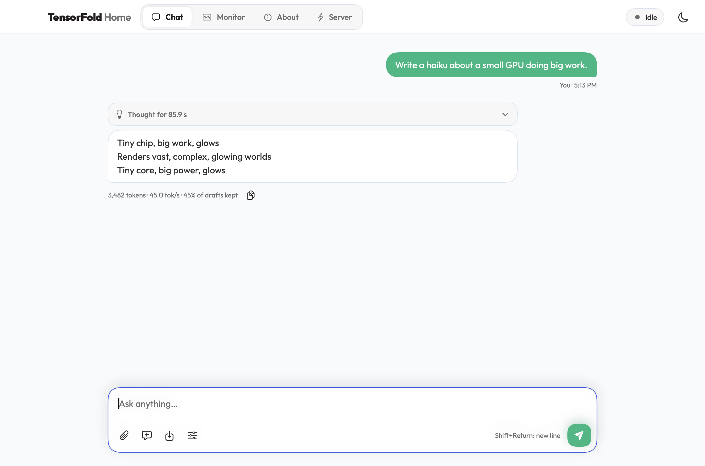
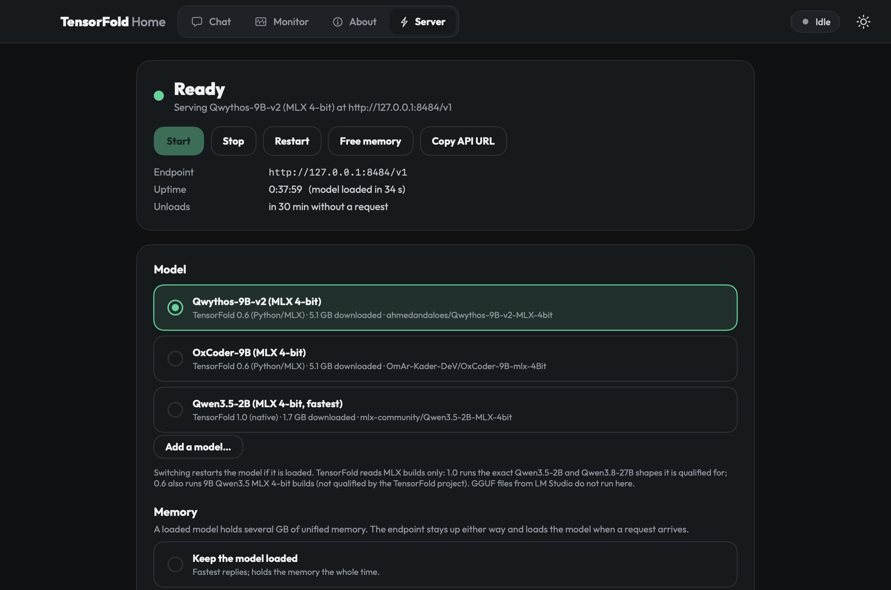

# TensorFold Home

**An unofficial Mac app for [TensorFold](https://github.com/ashhart/TensorFold).** It runs TensorFold's local model
server in the background and keeps one stable endpoint for Hermes and any other OpenAI- or Anthropic-compatible app.
It gives you a native window in the style of [StrataHome](https://github.com/majieddd/stratahome): Chat, a live
Monitor, an About page and server controls, with automatic TensorFold updates and a menu-bar item. You don't need a
browser or Terminal for any of it.



- **Download:** [TensorFoldHome.zip](https://github.com/majieddd/tensorfoldhome/releases/latest/download/TensorFoldHome.zip) (Apple silicon, macOS 14 or newer)
- **Not affiliated with TensorFold or its author.** TensorFold is Apache-2.0; the models it runs have their own licences.

## What is in the window

| Tab | What it does |
|---|---|
| **Chat** | Streaming answers with Markdown (headings, lists, tables, code blocks with a copy button). A collapsible "Thought for 2.1 s" block shows the model's reasoning. Each answer shows tokens, tok/s and how many of TensorFold's drafted tokens were kept. You can attach a text file (or drop one), start a New chat with Undo, and save the chat as Markdown. The **Sampling** drawer sets thinking (off / low / medium / high), temperature, top-p, top-k, max tokens and seed, and can share them with other apps. The conversation stays on this Mac. |
| **Monitor** | Live meters, refreshed every second. Model state (idle, loading, reading the prompt, generating, queued, error), decode and prefill speed, GPU load, unified memory and memory pressure, the engine's own memory against its budget, drafts kept, thermal state, CPU, disk. Below them: context fill, recent requests from every client (Hermes, Open WebUI, this app, scripts), the prompt cache, and **performance by TensorFold version**. |
| **About** | The loaded model and engine (format, decoder, context, drafts, weights in memory, memory budget, load time) and this Mac's chip, GPU, cores, memory and Metal's GPU memory limit. **Connect your tools** has copy-ready OpenAI and Anthropic base URLs and a ready-made Hermes config. Also the theme, the context length (16K to 256K) and whether the model thinks by default. |
| **Server** | **Start**, **Stop**, **Restart**, **Free memory** and **Copy API URL**. Pick the model, or add one from Hugging Face. Choose the memory mode: keep the model loaded, unload it when idle after N minutes, or load it on the first request. **Serve the model on the network** with an optional **API key**. Options, **TensorFold updates**, **TensorFold Home updates**, and the engine, endpoint, update, Open WebUI and app logs. |

Light and dark themes (or follow macOS), the Outfit font and the emerald accent come from StrataHome. Closing the
window keeps the app in the **menu bar**. The bolt there shows the state (filled when the model is loaded, outlined
when it is unloaded, crossed out when stopped). Its menu has Start, Stop, Restart, Free memory, the model list, Chat,
Monitor, Open WebUI and Copy API URL.

|  |  |
|---|---|
|  |  |

## How it fits together

```
 TensorFold Home (window + menu bar) ─┐
 Hermes / editors / scripts ──────────┼─► endpoint 127.0.0.1:8484 ──► TensorFold engine 127.0.0.1:18484
 Open WebUI :3000 (optional) ─────────┘     starts the engine on the      (0.6 for 9B Qwen3.5 models,
                                            first request, unloads it      1.0 for the models it is
                                            when idle, records stats       qualified for)
```

The **endpoint** is a small gateway that runs from login. It costs almost nothing while the model is unloaded. It
answers `/v1/models` with one model id (`tensorfold`) and a 64K context, and maps whatever model name a client sends
to the loaded model, so clients keep working when you switch models. It starts the engine when a generation request
arrives and records every request's tokens, cache reuse, prefill and decode speed, time to first token and drafts for
the Monitor. The same controls exist in Terminal as `tfctl`.

## Connect Hermes and other apps

| | |
|---|---|
| OpenAI base URL | `http://127.0.0.1:8484/v1` |
| Anthropic base URL | `http://127.0.0.1:8484` |
| Model id | `tensorfold` (any name is accepted and mapped to the loaded model) |
| API key | none on this Mac; send any value if a client insists |
| Context | 65,536 tokens by default (Hermes needs at least 64,000) |

Hermes (`~/.hermes/config.yaml`):

```yaml
model:
  provider: custom
  base_url: http://127.0.0.1:8484/v1
  default: tensorfold
  context_length: 65536
```

Tested with Hermes Agent 0.21.6 on an M5 with 24 GB: plain answers, terminal tool calls, and chat titles (which ask for
JSON-schema output; Set up installs TensorFold's `grammar` extra for that). Hermes's prompt with its tools is about
25,000 tokens. The first turn after the model loads reads all of it (about 36 s for a 9B). Later turns reuse it from the
prompt cache and start answering in about half a second.

Don't run a second local model server for Hermes at the same time (for example Hermes's own llama.cpp runtime with
the GGUF copy of the same model): two 9B models don't fit in 24 GB together, and everything slows to a crawl.

The first request after the model has been unloaded waits for it to load: about 35 s for a 9B model, 2 s for the 2B.
Hermes's long system prompt (about 13,600 tokens) takes about 18 s to read the first time. After that it is answered
from TensorFold's prompt cache in 0.4 to 5 s.

## Models

TensorFold reads **MLX** checkpoints, not the GGUF files LM Studio uses. Two engine lines are supported:

| Engine | Runs | Notes |
|---|---|---|
| TensorFold 1.0 (Homebrew) | the exact Qwen3.5-2B and Qwen3.8-27B shapes it is qualified for | has its own web dashboard; the 27B needs more than 24 GB |
| TensorFold 0.6 (Python/MLX) | also 9B Qwen3.5 MLX 4-bit builds | not qualified by the TensorFold project; its M5 kernels don't compile on macOS 26.2, so `tf06_no_tensor_units.py` runs it on the M1–M4 decoder |

The default list:

| key | model | engine |
|---|---|---|
| `qwythos-9b` (default) | [Qwythos-9B-v2 MLX 4-bit](https://huggingface.co/ahmedandaloes/Qwythos-9B-v2-MLX-4bit) | 0.6 |
| `oxcoder-9b` | [OxCoder-9B MLX 4-bit](https://huggingface.co/OmAr-Kader-DeV/OxCoder-9B-mlx-4Bit) | 0.6 |
| `qwen3.5-2b` | [Qwen3.5-2B MLX 4-bit](https://huggingface.co/mlx-community/Qwen3.5-2B-MLX-4bit) | 1.0 |

**Server > Model > Add a model…** adds any Hugging Face MLX repo (it goes into `models.conf`). A model downloads the
first time it starts.

### Measured on an Apple M5 with 24 GB

Single stream, greedy, thinking off, 400-token replies, median of 3. "Copy-heavy" asks for a 45-line function back with
two variables renamed, so most of the reply repeats the prompt.

| Model | Engine | Decode, prose | Decode, copy-heavy | Prefill |
|---|---|---:|---:|---:|
| Qwythos-9B-v2 MLX 4-bit | TensorFold 0.6 | 24.3 tok/s | **58.7 tok/s** | 802 tok/s |
| Qwythos-9B-v2 MLX 4-bit | LM Studio MLX | 24.5 tok/s | 24.3 tok/s | 680 tok/s |
| OxCoder-9B MLX 4-bit | TensorFold 0.6 | 24.7 tok/s | **65.6 tok/s** | 799 tok/s |
| Qwen3.5-2B MLX 4-bit | TensorFold 1.0 | 72.3 tok/s | **226.5 tok/s** | 888 tok/s |
| Qwen3.5-2B MLX 4-bit | LM Studio MLX | 99.2 tok/s | 98.9 tok/s | 3,248 tok/s |

TensorFold's drafts copy tokens from the prompt and keep only the ones the model would have written anyway, so output
is unchanged. They speed up replies that repeat their input (edits, refactors, quoting) by 2.4 to 3.1 times. On new
prose they add nothing. The Monitor's **Drafts kept** tile and the line under each chat answer show how much they
helped.

## What else it does

| | |
|---|---|
| **Memory modes** | Keep the model loaded, unload it after N idle minutes (default 30), or load it only on the first request. The endpoint stays up either way. |
| **Serving on the network** | Off by default. On, the endpoint listens on `0.0.0.0`, and other computers reach it at the address shown (e.g. `http://192.168.1.15:8484/v1`). **Require an API key** is a second, optional switch: **Generate** writes a random key; other computers send it as `Authorization: Bearer <key>` or `x-api-key`. Requests from this Mac never need it. If macOS asks whether Python may accept incoming connections, allow it. |
| **Shared sampling** | "Use for other apps too" in the Sampling drawer fills those settings into any request that leaves them out, so Hermes or Open WebUI get the same thinking level and temperature. |
| **TensorFold updates** | Daily at 04:30 (or at the next wake), and with **Check now** / **Update now**: TensorFold 1.0 from Homebrew, TensorFold 0.6 from its `python-0.6` branch (never moved to 1.0 inside its environment), Open WebUI from PyPI. Each update is checked (imports, CLI, an engine restart and health check). A failed TensorFold 0.6 or Open WebUI update is put back to the version you had. A busy model isn't restarted. |
| **TensorFold Home updates** | Checks this repository's releases on startup and every six hours. **Update** downloads `TensorFoldHome.zip` and checks its SHA-256 against the digest GitHub publishes for that asset. A download that doesn't match, or a release with no digest, is refused. The verified app goes in when you quit, and the version you had is kept in `updates/app-before-<version>`. |
| **Performance by TensorFold version** | Prefill and decode averages per TensorFold version and model, weighted by tokens, newest first, with the running version compared to the one before. It answers "is this update slower for me". |
| **Light on resources** | The meters are read every second while the window is open. Closed to the menu bar, the app checks the endpoint every 5 seconds and reads no meters. |

## Install

1. Download `TensorFoldHome.zip` from the [latest release](https://github.com/majieddd/tensorfoldhome/releases/latest), unzip it and move **TensorFold Home** to Applications.
2. The app isn't notarised, so the first time, **right-click it and choose Open**, then Open again. Or check the zip against the SHA-256 in the release notes, or build it yourself (below).
3. On a Mac without TensorFold yet, go to **Server > Set up**. It needs [Homebrew](https://brew.sh) and installs TensorFold 1.0, TensorFold 0.6 in its own Python environment, the endpoint and the daily updater (and Open WebUI if you tick it). Then press **Start**; the first start downloads the model (about 5 GB for a 9B).

Requirements: an Apple-silicon Mac with macOS 14 or newer. The 9B models were tested on 24 GB; the 2B model needs far less.

## Build it yourself

You only need the Xcode Command Line Tools (`xcode-select --install`); there's no Xcode project.

```bash
./build.sh
```

This writes `dist/TensorFold Home.app` and `dist/TensorFoldHome.zip` and prints the zip's SHA-256. `./build.sh dev`
builds into `dist/dev/`, so a running copy is never in the way. `./build.sh --install` also copies the app to
`~/Applications`. The sources are in `src/`, the backend scripts it installs are in `backend/`, and
`tools/make_icon.swift` draws the icon.

## Check that it works

```bash
"dist/TensorFold Home.app/Contents/MacOS/TensorFoldHome" --selftest
```

This runs 34 checks: Markdown parsing, version comparison, the SHA-256 gate on an app update, config.env and
models.conf edits, how attachments are fenced, the run states and the status pill, and this Mac's meters. If an
endpoint is running, it also reads its status (it doesn't send requests). Results go to
`~/Library/Application Support/TensorFoldHome/logs/selftest.txt`; exit code 0 means everything passed.

```bash
python3 -m unittest discover -s tools -p test_gateway.py -v
```

runs 12 tests of the endpoint against a mock engine on spare ports, with no model and no GPU: `/v1/models`, "a probe
doesn't wake the model", wake on demand and model-name rewriting, streams with and without usage, the Anthropic API,
shared sampling, the per-request stats, totals, history and per-version performance log, live state and client
disconnects, concurrent requests, idle unload and "keep loaded", and the API key on the network.

`--update-check` runs the real TensorFold Home release check and writes `logs/update-check.txt`; `--update-download`
also downloads the release's zip and verifies its SHA-256, app identity and version, staging nothing.

Other flags: `--minimized` (start in the menu bar), `--no-start` (don't start TensorFold on launch),
`--tab chat|monitor|about|server`, `--theme light|dark|system`, `--size WxH`, and `--probe` (writes what the app found
to `logs/probe.txt`, including whether the header gets its clicks). For screenshots there's `--screenshot <png>` with
`--delay SECONDS`, `--prompt "text"` (send one message first) and `--drawer`. Screenshot and probe runs don't save
settings or chats and don't unload the model when they quit. The images on this page are made with them.

## Command line

`tfctl` (linked into `~/.local/bin`) drives the same backend: `tfctl status`, `tfctl up`, `tfctl use oxcoder-9b`,
`tfctl mode idle 30`, `tfctl share on`, `tfctl update`, `tfctl endpoint`, `tfctl logs engine` (`tfctl help` lists
everything). The app and `tfctl` read and write the same settings, so either can be used.

## Where things are stored

| What | Where |
|---|---|
| App settings, the chat, app logs, update recovery copies | `~/Library/Application Support/TensorFoldHome/` |
| Backend settings (`config.env`), the model list (`models.conf`) | `~/Library/Application Support/TensorFoldLauncher/` |
| Backend scripts, logs, the per-request performance log, the API key | `…/TensorFoldLauncher/bin`, `logs`, `state/perf/requests.jsonl`, `state/api_key` |
| Python environments (TensorFold 0.6, Open WebUI) | `…/TensorFoldLauncher/venv-tf06`, `venv-webui` |
| launchd agents | `~/Library/LaunchAgents/com.tensorfold.gateway.plist`, `com.tensorfold.updater.plist`; engine and Open WebUI agents in `…/TensorFoldLauncher/launchd` |
| Open at login (only if you switch it on) | `~/Library/LaunchAgents/io.github.majieddd.tensorfoldhome.plist` |
| Models | the Hugging Face cache, `~/.cache/huggingface/hub` |

The backend folder keeps the `TensorFoldLauncher` name from the first version, so existing installs and Hermes
configs keep working.

## Known limits

- Apple silicon only. TensorFold itself is MLX on the Mac.
- The 9B models run on TensorFold 0.6 with a workaround for its M5 kernels; TensorFold's project doesn't qualify that setup. Qwen3.8-27B doesn't fit in 24 GB.
- Chat is text only: you can attach text files, but not pictures, and there are no tools. One conversation is kept at a time (New chat clears it; Undo brings it back for a few seconds).
- Not notarised (right-click > Open the first time).

## Licence

MIT, see [LICENSE](LICENSE). The look follows StrataHome (MIT), which follows Strata's web app (MIT). The app uses
the Outfit font (SIL OFL 1.1) and drives TensorFold (Apache-2.0), which it installs but doesn't include. See
[NOTICE.md](NOTICE.md).
